<p align="center">
  
</p>

<h3 align="center">فارماڤيك · Drug intelligence for Saudi Arabia, on official SFDA data</h3>

<p align="center">
Arabic-first mobile app and API for patients, pharmacists and pharma companies.<br>
Search any registered drug (even misspelled, Arabic or English), read its official record with its source,
find products with the same active ingredient, scan a box or a prescription, and ask an assistant that
answers <b>only from official sources, with citations</b>, in text or in a Saudi Arabic voice.
</p>

> **Not medical advice.** Pharmavique shows registry facts and official documents. It never gives a dose,
> never says "stop" or "switch", and never calls two products interchangeable on its own: equivalence is
> computed by rules and anything uncertain says "possible, needs a pharmacist's check".

---

## نبذة بالعربي

فارماڤيك منصة معلومات أدوية للسوق السعودي مبنية على بيانات الهيئة العامة للغذاء والدواء الرسمية:

- **بحث ذكي:** بالاسم التجاري أو المادة الفعالة، عربي أو إنجليزي، حتى لو فيه غلطة إملائية.
- **صفحة الدواء:** كل بيانات السجل الرسمي بمصدرها وتاريخ جلبها، والسعر المسجّل مع توضيح العملة.
- **نفس المادة الفعالة:** مرتبة من الأرخص، والحكم «متكافئ» أو «محتمل ويحتاج مراجعة الصيدلي» بتحسبه قواعد مكتوبة، مش الذكاء الاصطناعي.
- **مسح علبة الدواء أو الروشتة:** نموذج رؤية بيقرا الاسم ويطابقه بالسجل. الجرعة دايمًا «غير واضح» والصيدلي يقرر.
- **المساعد الذكي:** بيرد من مصادرنا بس ومعاه مراجع، بتلات مستويات (مبسّط، للصيدلي، متخصص). الرد ممكن يطلع **صوت باللهجة السعودية**.
- **سلامة الدواء:** تحذيرات الهيئة، والتعاميم والسحب، وتحديثات النشرات، وإجراءات تقليل المخاطر، ونقص الأدوية، ورسائل الأطباء والصيادلة.

المعمارية: **Modular Monolith** بأسلوب **DDD** و**Onion / Clean Architecture**، والقواعد دي بيفحصها `lint-imports` تلقائيًا في كل تشغيل.

---

## Contents

- [Status](#status)
- [Screens: wireframes and the running app](#screens-wireframes-and-the-running-app)
- [Features](#features)
- [Architecture](#architecture)
- [AI layer](#ai-layer)
- [Data sources](#data-sources)
- [Safety and privacy rules](#safety-and-privacy-rules)
- [Getting started](#getting-started)
- [API](#api)
- [Quality gates](#quality-gates)
- [Repository layout](#repository-layout)
- [Documentation](#documentation)
- [Roadmap](#roadmap)

## Status

| Area | State |
|---|---|
| SFDA drug registry | ✅ 9,162 drugs crawled with Arabic and English details; 9,144 loaded and searchable |
| Search | ✅ Arabic/English normalization, misspellings, trigram + exact signals fused by rank (recall@1 96% on 300 generated typos) |
| Drug page | ✅ every registry field with provenance, registered price with its currency label |
| Same active ingredient + equivalence | ✅ cheapest first, verdict computed by the `substitution` rules |
| Assistant (LLM + LangGraph + tools) | ✅ cited answers only, three levels, guardrails in code, Saudi dialect for spoken answers |
| Voice | ✅ speech to text (Whisper, Groq); Saudi Arabic voice (ElevenLabs `eleven_v3`, or Groq Orpheus Arabic Saudi) |
| Box / prescription scan (VLM OCR) | ✅ vision model reads the names, the registry search matches them, dose always "غير واضح" |
| Knowledge base (RAG) | ✅ chunking, embeddings, hybrid retrieval; 🔄 filled as the SFDA safety lists finish loading |
| SFDA safety lists (6 sources) | 🔄 lists crawled; detail pages, documents, OCR, loading and linking in progress |
| Mobile app (Expo) | ✅ home, search, drug page (light and dark) · 🔜 assistant, voice search, scan, my list screens |
| Accounts, roles, watchlist alerts, analytics | 🔜 contexts exist as skeletons |

## Screens: wireframes and the running app

The app is built screen by screen from the wireframes in [`pharmavique-wireframes/`](pharmavique-wireframes/)
(open `Pharmavique Wireframes.dc.html` over http). Left: the wireframe. Right: the running app on real SFDA data.

| | Wireframe | Running app |
|---|---|---|
| **B1 · Home** | 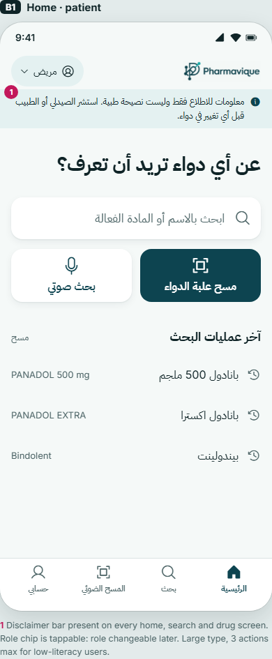 |  |
| **B3 · Search results** (misspelling → "did you mean") |  | 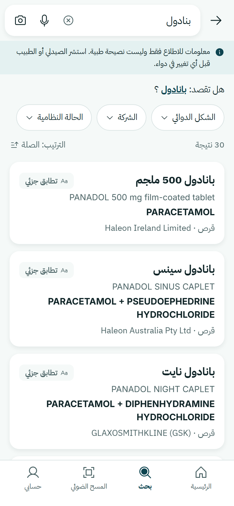 |
| **B8 · Drug page** |  | <br> |

<details>
<summary><b>More wireframes</b> (assistant, scan, prescription review, safety check, compare, pharmacist workspace, tokens)</summary>

| B16 · Assistant | B6 · Box scan | C2 · Prescription review | B20 · Safety check |
|---|---|---|---|
|  |  |  | 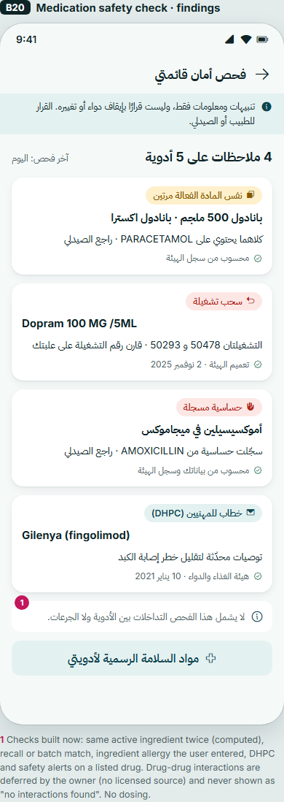 |

| B4 · Typing | B5 · Voice search | B11 · Compare | B14 · My list |
|---|---|---|---|
| 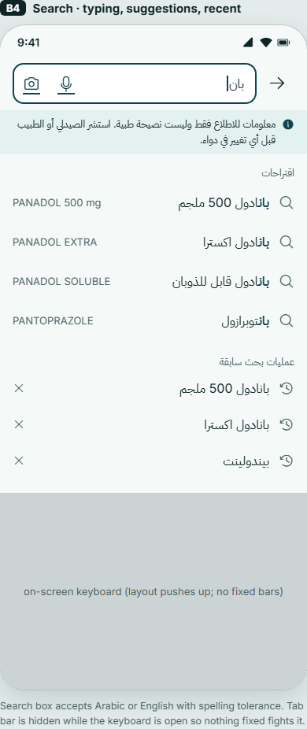 | 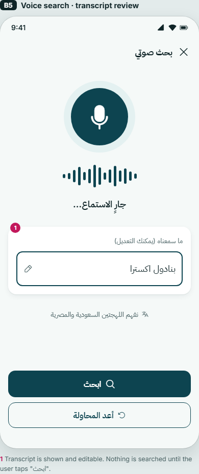 |  | 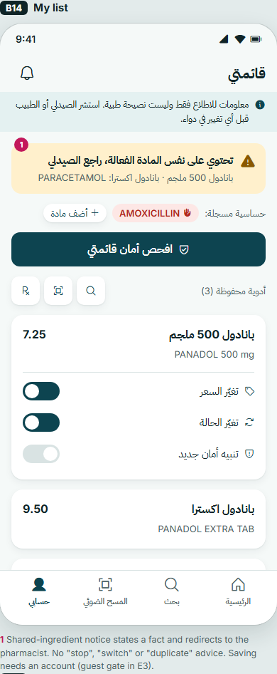 |

**C7 · Pharmacist workspace (desktop)**

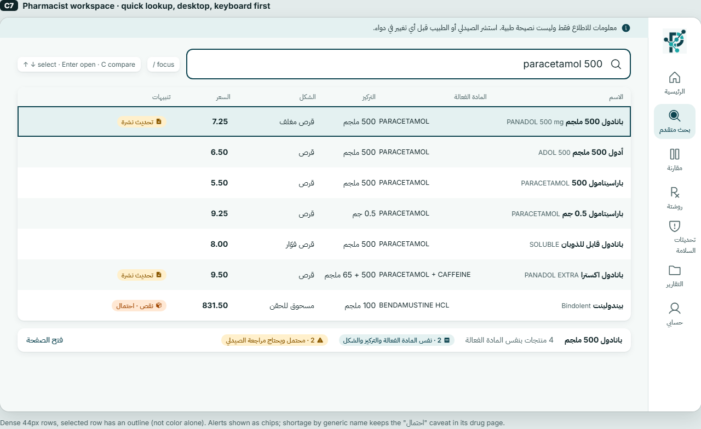

**D1 · Design tokens**

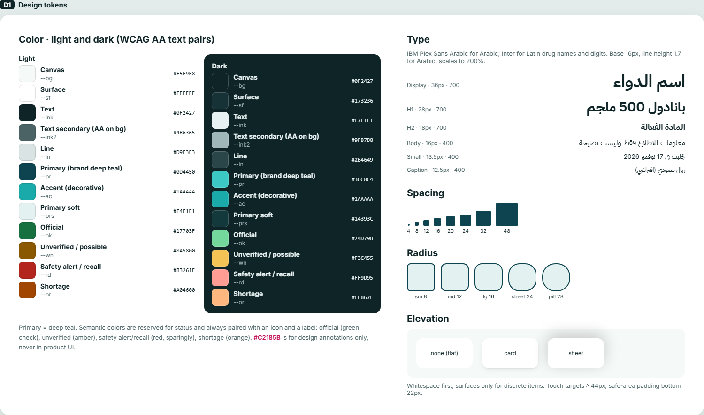

</details>

🔊 **Saudi Arabic voice sample:** [`docs/media/voice-sample-saudi.mp3`](docs/media/voice-sample-saudi.mp3)

## Features

| Feature | What it does | Rules it keeps |
|---|---|---|
| Smart search | Trade name, active ingredient or register number; Arabic normalization (diacritics, alef/ya/ta marbuta, Arabic-Indic digits); typo tolerant | Withdrawn products hidden unless asked for |
| Drug page | Ingredients and strengths, dosage form, route, package, legal status, ATC, storage, shelf life as stated, company and manufacturers, registered price | Every record shows source, fetch date and trust level; no unit is added where the source states none |
| Same active ingredient | Products with exactly the same ingredient set, cheapest first | Verdict from `substitution` rules: `equivalent` only when ingredients, strength (after unit normalization) and dosage-form family all match; anything unknown is `possible_needs_pharmacist_check` |
| Assistant | Questions about a drug answered from the registry and official SFDA documents | Cites every fact; "not in our sources" when nothing is found; dose, stop and switch instructions are blocked in code |
| Spoken answers | The assistant writes in Saudi dialect and the answer is read aloud | Citation marks and links are not spoken |
| Voice search | Speak the drug name; Whisper transcribes it (Arabic) | Audio processed in memory only |
| Box / prescription scan | A vision model reads names, strengths and forms; the registry search proposes candidates | Doses are never read: always "غير واضح"; every line needs a person's confirmation; the image is never stored |
| SFDA safety intelligence | Safety alerts, circulars and recalls, labeling updates, RMM materials, shortages, DHPC letters, linked to products | Official text quoted with its link and date |

## Architecture

**Modular monolith, Domain-Driven Design, onion (clean) architecture, API first.** One deployable
FastAPI service and worker jobs; inside it, bounded contexts that can only talk through published
contracts. The rules are not conventions: [`import-linter`](pyproject.toml) fails the build when any is
broken (8 contracts, all kept).

### Bounded contexts

| Context | Owns | State |
|---|---|---|
| `catalog` | The product aggregate (registry record, price history, listing status), outbox, read contracts | ✅ |
| `ingestion` | SFDA crawlers (drug list, 13 other lists, streaming crawler for giant lists), parsers, anti-corruption layer into the catalog | ✅ |
| `search` | Normalized product documents, trigram + exact signals, rank fusion, Postgres index | ✅ |
| `substitution` | Equivalence rules (ingredient set, normalized strength, dosage-form family) | ✅ |
| `knowledge` | Cited chunks of official documents, embeddings, hybrid retrieval (pgvector + trigram) | ✅ |
| `assistant` | Answer rules, citations, levels, the LangGraph agent and its tools | ✅ |
| `voice` | Speech to text and text to speech behind ports | ✅ |
| `recognition` | Box and prescription reading, candidates, review rules | ✅ (v1: in-request, nothing stored) |
| `media` | Product picture pipeline (shop sitemaps, OCR verification, placeholders) | ✅ |
| `identity`, `watchlist`, `analytics` | Accounts and roles, alerts on a user's drugs, company analytics | 🔜 skeletons |

Plus `shared_kernel` (market, currency, money, provenance, text normalization), `foundation`
(db engine, throttle, robots rules, concurrency) and `bootstrap`, the single composition root.

### Onion layers inside every context

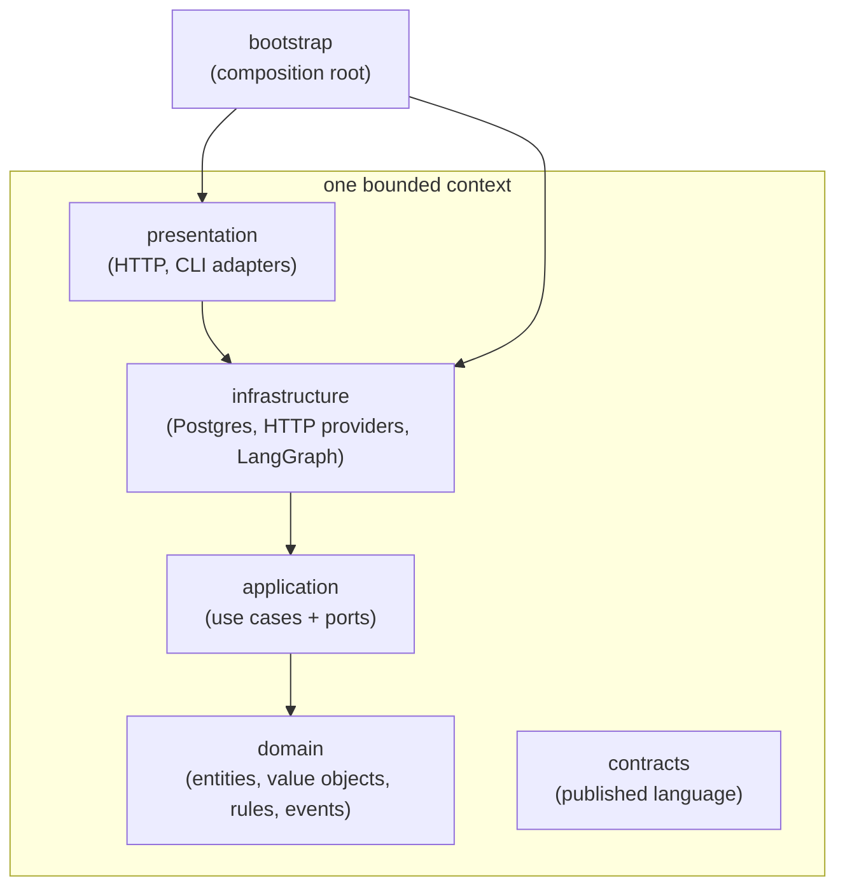

- Dependencies point inward only. `domain` and `application` import **no framework** (no SQLAlchemy,
  FastAPI, Pydantic, httpx, LangChain, LangGraph, OpenAI SDK): enforced by the `domain-purity` contract.
- Every external capability is a **port** in `application` with adapters in `infrastructure`
  (repositories, crawlers, `Embedder`, `VisionReader`, `TextToSpeech`, `SpeechToText`, `AgentRunner`).
  Each port has a fake adapter used by the tests; swapping a provider is configuration or one adapter.
- Contexts never import each other's internals; cross-context calls go through `<context>.contracts`
  from allow-listed adapter modules (the `context-independence` contract is the context map).

### Context map

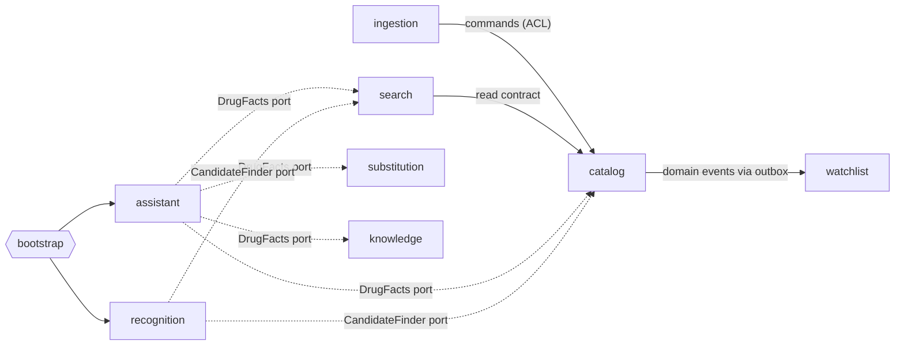

### DDD building blocks in the code

| Concept | Where |
|---|---|
| Aggregate with invariants and optimistic concurrency | `catalog/domain/product.py` (`Product`, versioned) |
| Value objects (immutable) | `IngredientLine`, `Money`, `Currency`, `Provenance`, `Strength`, `Citation`, ... |
| Domain events + transactional outbox | `catalog/domain/events.py`, `catalog/infrastructure/persistence/outbox.py` |
| Anti-corruption layer | `ingestion` maps SFDA pages into catalog commands |
| Published language | each `contracts/` package |
| Repository + unit of work | `catalog/infrastructure/persistence/` |
| One Postgres schema per context | `catalog`, `search`, `knowledge` (no cross-schema keys or joins) |

### How an assistant answer is made

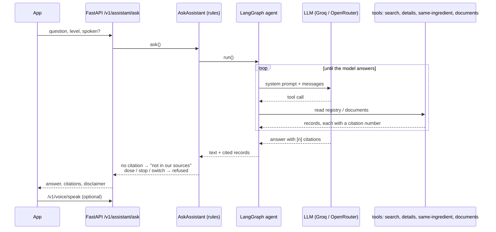

### Scalability

Stateless API processes behind a load balancer; Postgres (pg_trgm + pgvector) per-context schemas; Redis
for queues and caches; crawls and embeddings as background jobs; the outbox decouples contexts so any
context can later move to its own service without changing its domain (see
[ADR-001](docs/adr/ADR-001-modular-monolith-vs-microservices.md) and
[ADR-004](docs/adr/ADR-004-scalability.md)). Free-tier AI providers sit behind fallbacks: the vision reader
tries several models in order, retrieval falls back to text search when embeddings are down.

## AI layer

| Capability | Port (application) | Adapter (infrastructure) | Default provider / model |
|---|---|---|---|
| LLM with tool calling | `AgentRunner` | `LangGraphAgentRunner` (StateGraph + ToolNode) | Groq `openai/gpt-oss-120b` (or any OpenRouter model) |
| Embeddings | `Embedder` | `OpenAICompatibleEmbedder` | OpenRouter `baai/bge-m3` (1024 dims) |
| Retrieval | `PassageSearch` | Postgres pgvector + trigram, fused by rank | — |
| Vision OCR (box, prescription) | `VisionReader` | `OpenAICompatibleVisionReader` + `FallbackVisionReader` | OpenRouter `nvidia/nemotron-3.5-super-vl:free` → `google/gemma-4-31b-it:free` → `inclusionai/ling-3.2-flash:free` |
| Speech to text | `SpeechToText` | `GroqSpeechToText` | Groq `whisper-large-v3-turbo` |
| Text to speech (Saudi) | `TextToSpeech` | `ElevenLabsTextToSpeech`, `GroqTextToSpeech` | ElevenLabs `eleven_v3` (voice id configurable), or Groq `canopylabs/orpheus-arabic-saudi` |

Model ids are configuration (`PHARMAVIQUE_*` environment variables), never code. The system prompt is in
[`assistant/infrastructure/prompts.py`](src/pharmavique/assistant/infrastructure/prompts.py); the rules that
are enforced after the model are in [`assistant/domain/answers.py`](src/pharmavique/assistant/domain/answers.py).

## Data sources

All data comes from the official SFDA website (crawled politely: robots.txt respected, throttled, stops on
blocks, never touches CAPTCHA forms). Every record keeps its provenance and `trust = official`.

| Source | Records | Use |
|---|---|---|
| Registered drugs list + details (Arabic and English) | 9,162 | catalog, search, drug page, assistant |
| Drug safety alerts | 276 | safety intelligence, knowledge |
| Drugs circulars and withdrawal | 146 | recalls, knowledge |
| Drug safety labeling updates | 241 of 261 shown by the site | knowledge |
| Risk minimization measures (RMM) | 578 | patient safety center, knowledge |
| Drug shortage (current / resolved) | 723 / 586 | shortage status |
| DHPC letters | 105 | knowledge |
| Drug companies | 6,135 | company views |

The dataset is versioned under [`data/`](data/). Licences and status per source:
[docs/DATA_SOURCES.md](docs/DATA_SOURCES.md). Egypt is planned as a CSV-import adapter marked
`unofficial_unverified` (no scraping).

## Safety and privacy rules

- Never medical advice: no dosing, never "stop" or "switch"; the pharmacist or doctor decides.
- Equivalence is computed by code; anything uncertain is "possible, needs pharmacist check".
- The LLM answers only from retrieved records and documents, with citations; otherwise it says so.
- Text from documents is treated as data, never as instructions to the model.
- Currencies are never assumed silently: SAR is the owner's stated assumption and is labelled as such.
- Photos and voice are processed in memory and never stored or logged; secrets live only in `.env`.

## Getting started

Requirements: Python 3.12, [uv](https://docs.astral.sh/uv/), Docker, Node 20+ (for the app).

```bash
cp .env.example .env                      # set the Postgres password and your provider keys
uv sync                                   # Python dependencies
docker compose up -d db redis             # Postgres (pg_trgm + pgvector) and Redis
uv run alembic upgrade heads              # every context's schema
```

Load the data that ships in `data/` (no crawl needed):

```bash
uv run pharmavique sfda-load --run-id full-20261116 --from-records   # 9,144 drugs into the catalog
uv run pharmavique search-reindex                                     # build the search index
uv run pharmavique sfda-lists-load --run-id lists-1                   # SFDA safety lists, linked to drugs
uv run pharmavique knowledge-build --run-id lists-1                   # cited chunks for the assistant
```

Run the API (bound to the network so a phone can reach it):

```bash
uv run uvicorn pharmavique.bootstrap.api:create_app --factory --host 0.0.0.0 --port 8000
# http://127.0.0.1:8000/docs
```

Run the app on a phone with Expo Go (same Wi-Fi as the computer):

```bash
cd mobile && npm ci
EXPO_PUBLIC_API_URL=http://<your computer's LAN IP>:8000 npx expo start
```

AI features need keys in `.env` (each feature answers 503 until its key is set):
`PHARMAVIQUE_GROQ_API_KEY` (assistant, speech to text), `PHARMAVIQUE_OPENROUTER_API_KEY` (embeddings,
vision), `PHARMAVIQUE_ELEVENLABS_API_KEY` and `PHARMAVIQUE_ELEVENLABS_VOICE_ID` (Saudi voice).

Re-collect the SFDA safety lists from the site (hours, resumable):

```bash
bash scripts/recollect_safety_lists.sh
```

## API

| Method | Path | Purpose |
|---|---|---|
| GET | `/health` | liveness |
| GET | `/v1/search?q=` | find drugs by name, ingredient or register number |
| GET | `/v1/products/{register_number}` | product card |
| GET | `/v1/products/{register_number}/details` | the drug page: every field with provenance |
| GET | `/v1/products/{register_number}/same-ingredient` | same ingredient set, cheapest first, with verdict |
| POST | `/v1/assistant/ask` | `{question, level, register_number?, spoken?}` → cited answer |
| POST | `/v1/voice/transcribe` | audio upload → text (Arabic) |
| POST | `/v1/voice/speak` | `{text}` → audio in the Saudi Arabic voice |
| POST | `/v1/recognition/scan?kind=box\|prescription` | photo → lines with registry candidates |

Interactive documentation: `/docs` (OpenAPI).

## Quality gates

Run before every commit (and in CI, [`.github/workflows/ci.yml`](.github/workflows/ci.yml)):

```bash
uv run ruff check . && uv run ruff format --check .
uv run mypy src tests            # strict typing
uv run lint-imports              # 8 architecture contracts
uv run pytest                    # 700+ unit tests, plus integration tests on Postgres
cd mobile && npx tsc --noEmit    # the app's types
```

Tests come before adapters, and every bug fix starts with a failing test.

## Repository layout

```
src/pharmavique/
  <context>/contracts | domain | application | infrastructure | presentation
  shared_kernel/  foundation/  bootstrap/      # shared value objects, technical base, composition root
tests/unit · tests/integration · tests/architecture
mobile/                                        # Expo (React Native) app, Arabic-first RTL
pharmavique-wireframes/                        # the wireframes the app follows
data/                                          # the SFDA dataset (versioned)
docs/                                          # architecture, ADRs, plans, data sources, handoff
scripts/                                       # crawl, OCR and maintenance scripts
```

## Documentation

- [Project brief](docs/PROJECT_BRIEF.md) · [Architecture](docs/ARCHITECTURE.md) · [AI architecture](docs/AI_ARCHITECTURE.md)
- [Domain model](docs/DOMAIN_MODEL.md) · [Features](docs/FEATURES.md) · [Phase 2 plan and owner decisions](docs/PHASE_2_PLAN.md)
- [Data sources](docs/DATA_SOURCES.md) · [SFDA scraper](docs/SFDA_SCRAPER.md) · [Media pipeline](docs/MEDIA_PIPELINE.md)
- ADRs: [001 modular monolith](docs/adr/ADR-001-modular-monolith-vs-microservices.md) ·
  [002 job queue](docs/adr/ADR-002-job-queue.md) · [003 search](docs/adr/ADR-003-search-strategy.md) ·
  [004 scalability](docs/adr/ADR-004-scalability.md) · [005 AI providers](docs/adr/ADR-005-ai-providers-behind-ports.md) ·
  [006 pgvector](docs/adr/ADR-006-pgvector-and-document-chunks.md) · [007 LangGraph](docs/adr/ADR-007-langgraph-in-infrastructure.md)
- [Open questions](docs/OPEN_QUESTIONS.md) · [Handoff](docs/HANDOFF.md)

## Roadmap

1. Finish loading the six SFDA safety lists and fill the knowledge base with their documents.
2. App screens: assistant (B16) with listen, voice search (B5), box and prescription scan (B6, C1, C2).
3. My medication list (B14) and safety check (B20): duplicate ingredient, ingredient allergy, recalls and alerts.
4. Accounts and roles (`identity`), alerts on a user's drugs (`watchlist`), the outbox relay.
5. Price history screen (B12) from SFDA snapshots, and online pharmacy prices marked "unverified".
6. Egypt CSV-import adapter. Drug interactions wait for a licensed source (owner's decision).
