<p align="center">
  <picture>
    <source media="(prefers-color-scheme: dark)" srcset="pharmavique-wireframes/brand/logo-white.png">
    
  </picture>
</p>

<h3 align="center">Know your medicine.</h3>

<p align="center">
  Pharmavique helps people in Saudi Arabia understand the medicines they use.<br>
  Find any registered medicine in seconds, see what it contains and where the information comes from,<br>
  discover other products with the same active ingredient, and stay informed about official safety alerts and recalls.
</p>

<p align="center">
  Search by name, point your camera at a medicine box or a prescription,<br>
  or simply ask a question and hear the answer in a Saudi Arabic voice.
</p>

<p align="center">
  Built for patients, pharmacists and pharmaceutical companies.
</p>

---

## Table of contents

1. [Overview](#1-overview)
2. [Project status](#2-project-status)
3. [Screens](#3-screens)
4. [Features in depth](#4-features-in-depth)
5. [AI layer](#5-ai-layer)
6. [Guardrails and anti-hallucination](#6-guardrails-and-anti-hallucination)
7. [Observability](#7-observability)
8. [Architecture](#8-architecture)
9. [Data](#9-data)
10. [Tech stack](#10-tech-stack)
11. [Getting started](#11-getting-started)
12. [Configuration reference](#12-configuration-reference)
13. [Command line reference](#13-command-line-reference)
14. [API reference](#14-api-reference)
15. [Testing and quality gates](#15-testing-and-quality-gates)
16. [Security and privacy](#16-security-and-privacy)
17. [Repository layout](#17-repository-layout)
18. [Documentation index](#18-documentation-index)
19. [Roadmap](#19-roadmap)
20. [Disclaimer](#20-disclaimer)

---

## 1. Overview

Pharmavique is a multi-tenant drug information platform for three audiences: **patients**,
**pharmacists** and **pharmaceutical companies**. Saudi Arabia is the first market; Egypt is planned
as a pluggable import adapter.

Everything the product shows comes from the official registry of the Saudi Food and Drug Authority
(SFDA) and its public safety publications, collected politely and stored with full provenance. On top
of that data the platform adds:

- a typo-tolerant, bilingual search (Arabic and English trade names, active ingredients, register numbers),
- a drug page with every registry field and where it came from,
- a rule-based equivalence engine that never lets a language model decide interchangeability,
- an AI assistant that answers from retrieved records with numbered citations, at three levels of detail,
- a Saudi Arabic voice for spoken answers and speech-to-text for voice search,
- a vision model that reads medicine boxes and prescriptions and matches them to the registry,
- SFDA safety intelligence: safety alerts, recalls and circulars, labeling updates, risk minimization
  materials, shortages and letters to healthcare professionals.

The project is **API first**: the mobile app holds no drug data of its own and every screen calls the API.

## 2. Project status

| Area | Status | Notes |
|---|---|---|
| SFDA drug registry | Done | 9,162 registered drugs crawled with Arabic and English details; 9,144 loaded and searchable |
| Search | Done | Recall@1 of 96% and recall@10 of 100% on 300 generated misspellings of real names |
| Drug page API | Done | Every registry field, price with its currency basis, provenance |
| Same active ingredient and equivalence | Done | Cheapest first, verdict computed by the `substitution` rules |
| Assistant (LLM, LangGraph, tools) | Done | Citations, three levels, spoken answers in Saudi dialect |
| Guardrails | Done | Emergency detection, injection rules plus a learned classifier, dose and stop rules, numeric grounding check |
| Observability | Done | Structured events, Prometheus metrics, request ids |
| Voice | Done | Whisper speech-to-text; Saudi Arabic text-to-speech through ElevenLabs or Groq |
| Box and prescription scan | Done | Vision model with automatic fallback across models, registry matching, mandatory review |
| Knowledge base (RAG) | Done | Chunking, embeddings, hybrid retrieval; content grows as the safety lists finish loading |
| SFDA safety lists | In progress | All six lists crawled; detail pages, documents, OCR, loading and linking running |
| Mobile app | In progress | Home, search and drug page done in light and dark mode; assistant, voice, scan and list screens next |
| Accounts, roles, watchlist alerts, analytics | Planned | Bounded contexts exist as skeletons |

## 3. Screens

All phone screens below are shown at the same size (390 × 844 points). Wireframes live in
[`pharmavique-wireframes/`](pharmavique-wireframes/); open `Pharmavique Wireframes.dc.html` over HTTP
(for example `python -m http.server`) for the interactive canvas with clickable flows.

### 3.1 Wireframe and running app, side by side

The running app uses real SFDA data. Light and dark themes follow the design tokens in section 3.4.

| Screen | Wireframe | App, light | App, dark |
|:---:|:---:|:---:|:---:|
| Home |  | 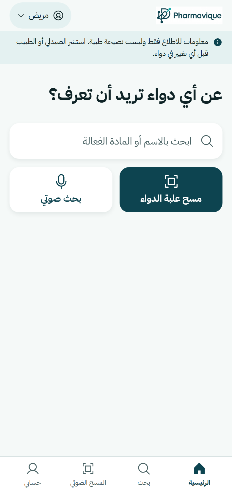 | 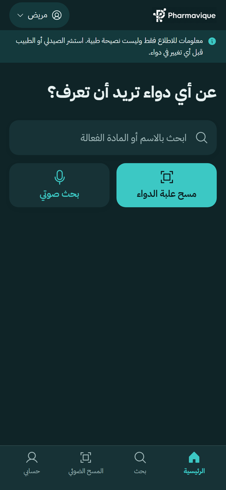 |
| Search results | 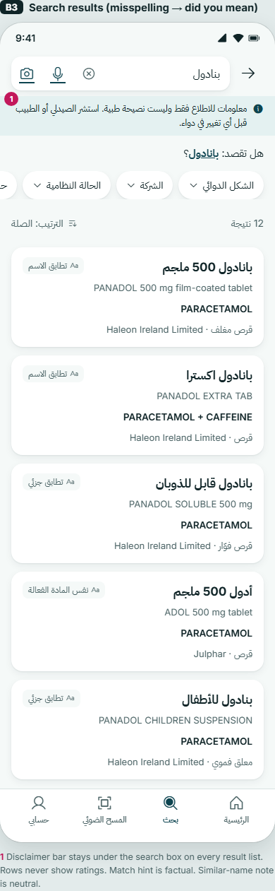 |  | 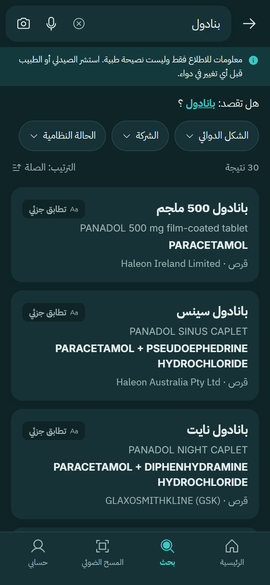 |
| Drug page | 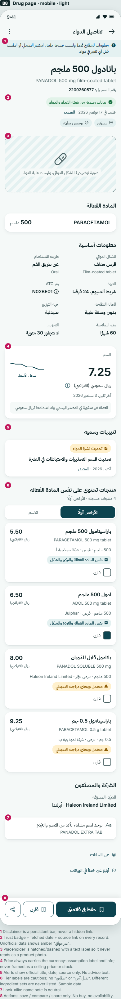 | 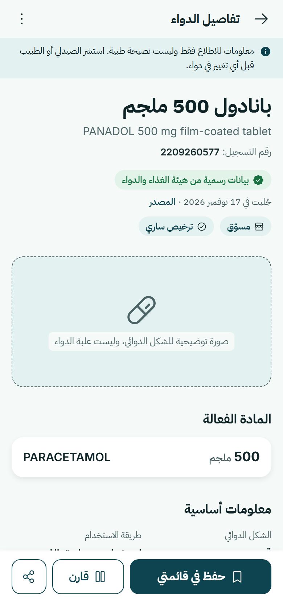 |  |
| Equivalents and compare | 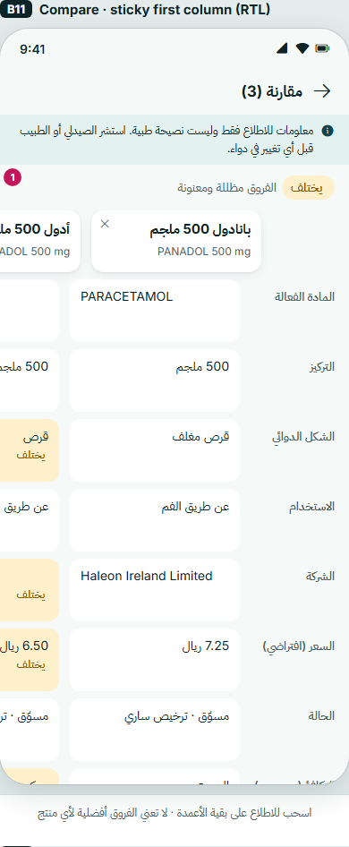 |  |  |

### 3.2 Wireframe gallery: patient

| Splash | Introduction | Role choice | Typing with suggestions |
|:---:|:---:|:---:|:---:|
| 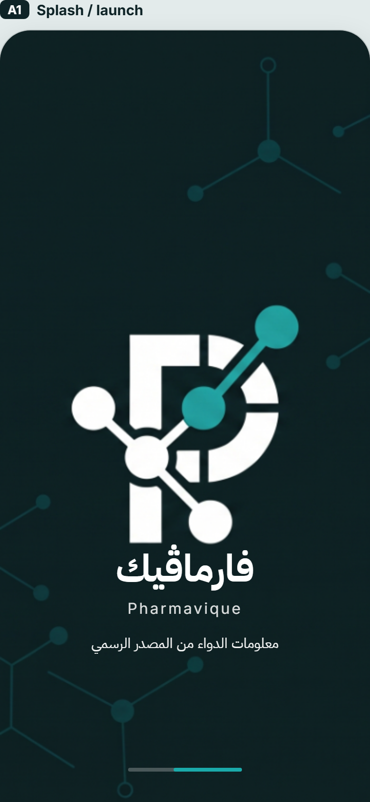 | 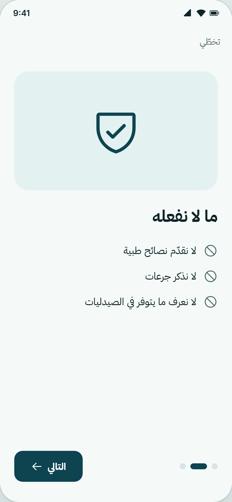 |  |  |

| Voice search | Box scan | Scan result | Price history |
|:---:|:---:|:---:|:---:|
|  | 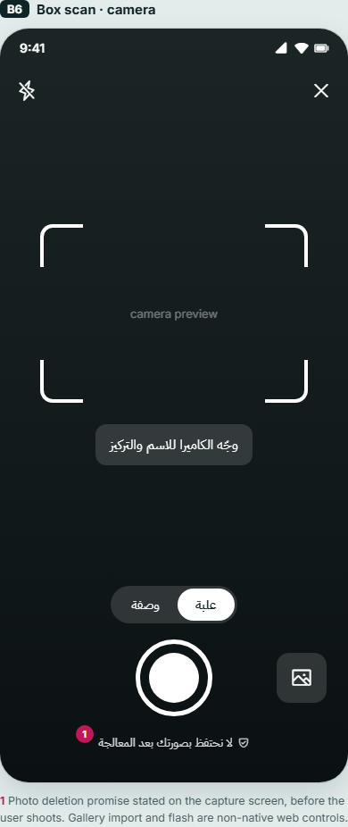 |  | 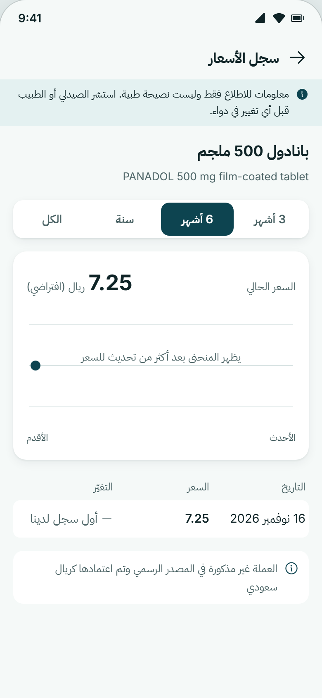 |

| My medication list | Alerts | Assistant | Safety check |
|:---:|:---:|:---:|:---:|
|  |  | 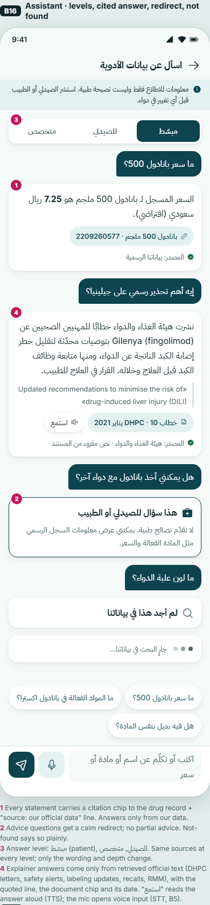 |  |

| Recall detail | Patient safety center | Account | Data and trust |
|:---:|:---:|:---:|:---:|
| 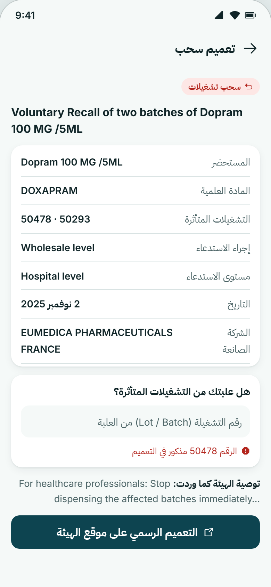 | 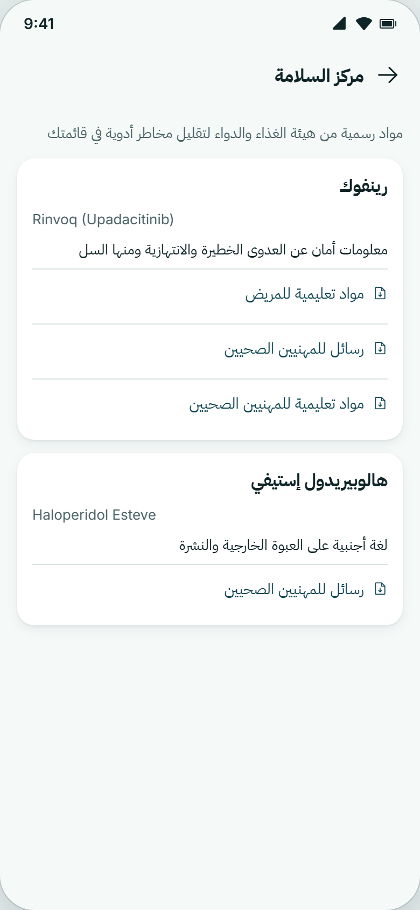 | 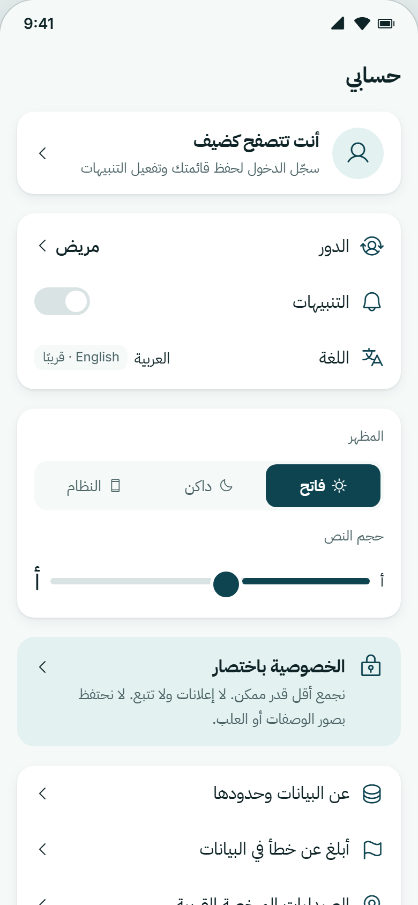 |  |

### 3.3 Wireframe gallery: pharmacist

| Prescription capture | Prescription review | Shelf scan | Scan summary |
|:---:|:---:|:---:|:---:|
|  | 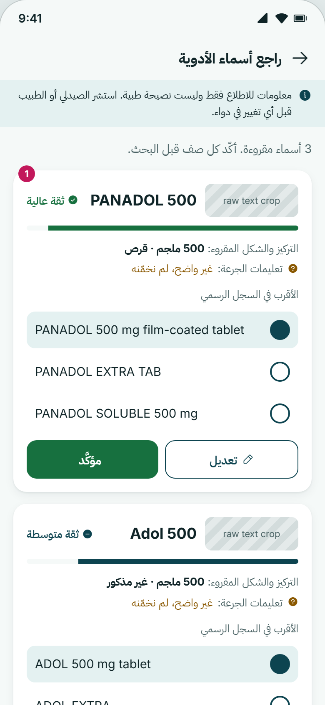 |  |  |

| Desktop drug page | Pharmacist workspace (desktop) |
|:---:|:---:|
|  |  |

### 3.4 Design system

| Token | Light | Dark | Use |
|---|---|---|---|
| `bg` | `#F5F9F8` | `#0F2427` | Canvas |
| `sf` | `#FFFFFF` | `#173236` | Surfaces (cards, bars) |
| `ink` | `#0F2427` | `#E7F1F1` | Primary text |
| `ink2` | `#4B6365` | `#9FB7B8` | Secondary text (WCAG AA on `bg`) |
| `pr` | `#0D4450` | `#3CC8C4` | Brand primary (deep teal) |
| `prs` | `#E4F1F1` | `#14393C` | Primary soft (disclaimer bar, chips) |
| `ok` | `#17703F` | `#74D79B` | Official data |
| `wn` | `#8A5800` | `#F3C455` | Unverified, or needs a pharmacist's check |
| `rd` | `#B3261E` | `#FF9D95` | Safety alert or recall |
| `or` | `#A04600` | `#FFB67F` | Shortage |

- Type: IBM Plex Sans Arabic for Arabic text, Inter for Latin drug names and digits; base size 16, line height 1.7 for Arabic.
- Radius: 8, 12, 16, 24 (sheets), pill. Card elevation: two soft shadows. Touch targets are at least 44 points.
- Semantic colors always come with an icon and a label, never color alone. Layout is right to left.

## 4. Features in depth

### 4.1 Search

1. **Normalization** of Arabic and Latin text: diacritics removed, alef, ya and ta marbuta variants unified,
   Arabic-Indic digits converted, punctuation and spacing folded; an alias table covers common spellings.
2. **Signals**: an exact signal (register number, exact normalized name) and a fuzzy signal
   (PostgreSQL `pg_trgm` trigram similarity over trade names, the brand part of each name, and ingredients).
3. **Fusion**: reciprocal rank fusion of the signals; each result keeps its per-signal rank and score so the
   app can explain the match ("name match", "partial match", "same active ingredient").
4. **Measured**: making the brand part of a registry name a searchable term raised recall@1 on 300
   generated misspellings from 76% to 96% (recall@10 100%). BM25 over descriptive words added little
   and is not used.

### 4.2 Drug page

Trade names (Arabic and English), register number, active ingredients with strength and unit, dosage
form, route of administration, package, legal status (OTC or prescription), distribution site, ATC
codes, shelf life exactly as stated (the source gives no unit, so none is added), storage conditions,
marketing company and country, manufacturers, marketing and authorization status, the registered price
with its currency basis, and provenance (source, source URL, fetch time, trust level).

### 4.3 Same active ingredient and equivalence

Products with exactly the same set of active ingredients are listed cheapest first. Each row carries a
verdict computed by the `substitution` domain, never by a language model:

| Ingredient set | Strength (after unit normalization) | Dosage-form family | Verdict |
|---|---|---|---|
| Same | Same | Same | `equivalent` |
| Same | Different | any | `not_equivalent` |
| Same | Unknown or unreadable | any | `possible_needs_pharmacist_check` |
| Same | Same | Different or unknown wording | `possible_needs_pharmacist_check` |
| Different | any | any | never listed |

Strength normalization is exact (fractions, not floats): 500 mg equals 0.5 g, 120 mg per 5 ml equals
24 mg per ml.

### 4.4 Assistant

- **Levels**: simple (patient), detailed (pharmacist), clinical (specialist). Same sources, different depth.
- **Tools** the model can call, all read-only:

| Tool | Returns |
|---|---|
| `search_drugs(query)` | Up to 8 registered products by name, ingredient or register number |
| `drug_details(register_number)` | Every registry field of one product, with its source |
| `same_ingredient(register_number)` | Same-ingredient products, cheapest first, with the computed verdict |
| `search_documents(query, register_number?)` | Passages of official SFDA documents, hybrid retrieval |

- **Citations**: every record a tool returns gets a number; the model cites `[n]`; the runner keeps only
  citations that point at records really retrieved and renumbers them in order.
- **Spoken answers**: with `spoken = true`, the model writes in everyday Saudi dialect, in short spoken
  sentences, and the text is sent to the Saudi Arabic voice (citation marks and links are not read aloud).

### 4.5 Voice

- **Speech to text**: Whisper (`whisper-large-v3-turbo`) through Groq, with an Arabic language hint.
- **Text to speech**: ElevenLabs (`eleven_v3`, any voice id, MP3) by default, or Groq Orpheus Arabic Saudi
  (six Saudi dialect voices, WAV, 200 characters per request). Long text is split at sentence ends to fit
  each provider's limit and the audio is joined into one file.

### 4.6 Box and prescription scan

1. The photo (JPEG, PNG or WebP, up to 8 MB) is sent to a vision-language model as an in-memory data URL.
2. The model transcribes medicine names, strengths and dosage forms only, as JSON. It is told never to
   read doses or instructions.
3. Each line is matched against the registry with the same search used for typed text (top 3 candidates).
4. Every line is marked for review; on prescriptions the dose is always reported as **unclear** for the
   pharmacist to confirm. The image is never stored.
5. Free models are often busy, so readers are tried in order until one answers.

Measured on a real box photo: `nvidia/nemotron-3.5-super-vl:free` read it correctly in about 6 seconds,
and the first registry candidate was the exact product with a score of 1.0.

### 4.7 SFDA safety intelligence

Safety alerts, drug circulars and withdrawals, safety labeling updates, risk minimization materials,
current and resolved shortages, and letters to healthcare professionals are crawled, their detail pages
and documents downloaded, PDF text extracted (with OCR for scanned files), rows linked to products, and
the text cut into cited chunks for the assistant.

## 5. AI layer

| Capability | Port (application layer) | Adapter (infrastructure layer) | Default provider and model |
|---|---|---|---|
| Language model with tool calling | `AgentRunner` | `LangGraphAgentRunner` (StateGraph, ToolNode) | Groq `openai/gpt-oss-120b` |
| Prompt-injection classifier | `InjectionDetector` | `GroqPromptGuard` | Groq `meta-llama/llama-prompt-guard-2-86m` |
| Embeddings | `Embedder` | `OpenAICompatibleEmbedder` | OpenRouter `baai/bge-m3` (1024 dimensions) |
| Retrieval | `PassageSearch` | pgvector cosine plus trigram, fused by rank | PostgreSQL |
| Vision OCR | `VisionReader` | `OpenAICompatibleVisionReader`, `FallbackVisionReader` | OpenRouter `nvidia/nemotron-3.5-super-vl:free`, then `google/gemma-4-31b-it:free`, then `inclusionai/ling-3.2-flash:free` |
| Speech to text | `SpeechToText` | `GroqSpeechToText` | Groq `whisper-large-v3-turbo` |
| Text to speech | `TextToSpeech` | `ElevenLabsTextToSpeech`, `GroqTextToSpeech` | ElevenLabs `eleven_v3`, or Groq `canopylabs/orpheus-arabic-saudi` |

Model ids, providers and keys are configuration, never code. Every port has a fake adapter used by the
unit tests, so no test needs a network or a key.

**How an answer is produced**

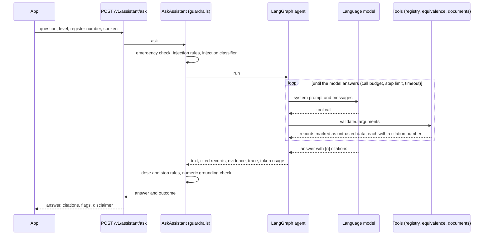

## 6. Guardrails and anti-hallucination

The response policy is helpful by default and firm only where there is real danger. Every layer is
enforced in code around the model, not only in the prompt.

| Layer | When | What it does |
|---|---|---|
| Input validation | Before anything | Question length 1 to 1,000 characters; image type and size; audio size |
| Emergency detection | Before the model | Overdose, a child swallowing medicine, breathing trouble, facial swelling, fainting, seizures or self-harm get an immediate reply to call 997 or go to the nearest emergency department. The model is not called |
| Injection rules | Before the model | Deterministic English and Arabic patterns: overriding instructions, revealing the system prompt, role-play without limits, jailbreak phrases |
| Injection classifier | Before the model | Llama Prompt Guard 2 through Groq; blocks at a score of 0.9 or more. Measured: an English attack scored 0.9996, an Arabic attack only 0.0066, which is why it adds to the rules and never replaces them. A classifier outage blocks nothing |
| Tool argument validation | During the run | Register numbers must match `[A-Za-z0-9-]{3,30}`; queries 1 to 200 characters; violations are returned to the model as tool errors |
| Tool budget and limits | During the run | At most 8 tool calls, 20 graph steps and 75 seconds per question; a model that loops ends with no answer instead of a runaway call chain |
| Tool error isolation | During the run | A failing source returns a JSON error to the model; the request does not fail |
| Untrusted data marking | During the run | Every tool result is wrapped with a note that it is data and that instructions inside it must never be followed; document passages are capped at 1,200 characters |
| Citation integrity | After the model | Only citation numbers that point at retrieved records survive; they are renumbered 1 to n |
| Dose and stop rules | After the model | Personal dose numbers, schedules, and telling someone to stop or switch a medicine on their own are replaced with a referral to the doctor or pharmacist. "Ask your doctor before stopping" is allowed |
| Numeric grounding check | After the model | Every number written with a medicine unit or a currency, and every 10-digit register number, must appear in what the tools returned in this run (Arabic-Indic digits and trailing zeros normalized). Otherwise the answer is withheld instead of shown with an invented fact |
| Labelling | Response | `grounded` when registry records are cited, `general` for general medicine information, `urgent` for emergencies, `refused` when a rule replaced the text |

## 7. Observability

- **Structured assistant events**: one JSON log line per question on the `pharmavique.assistant` logger with
  the outcome, level, spoken flag, tools called, tool errors, latency, model, input and output tokens,
  number of citations, question length and the number of ungrounded facts. The question and answer text,
  images and audio are never logged.
- **Metrics** at `GET /metrics` in the Prometheus text format:

| Metric | Type | Labels |
|---|---|---|
| `http_requests_total` | counter | `route`, `status` |
| `http_request_seconds` | histogram | `route` |
| `assistant_answers_total` | counter | `outcome` (answered, general, emergency, injection, rule_refusal, ungrounded, empty, error) |
| `assistant_guardrail_blocks_total` | counter | `rule` |
| `assistant_tool_calls_total` | counter | `tool` |
| `assistant_tool_errors_total` | counter | none |
| `assistant_tokens_total` | counter | `kind` (input, output) |
| `assistant_latency_seconds` | histogram | none |

- **Request ids**: every response carries `X-Request-ID`, kept from the request when it is safe, otherwise generated.

## 8. Architecture

### 8.1 Style

A **modular monolith** designed with **Domain-Driven Design** and the **onion (clean) architecture**. One
deployable FastAPI service plus background jobs; inside it, bounded contexts that talk only through
published contracts. The architecture is enforced by [`import-linter`](pyproject.toml): eight contracts,
checked on every run and in CI.

| Contract | Rule |
|---|---|
| `onion-layers` | Inside each context, presentation, infrastructure, application, domain: dependencies point inward |
| `presentation-isolation` | Presentation never imports infrastructure or domain directly |
| `infrastructure-not-presentation` | Infrastructure never imports presentation |
| `context-independence` | Contexts never import each other, except allow-listed adapters importing another context's `contracts` |
| `domain-purity` | Domain, application and the shared kernel import no framework: no SQLAlchemy, FastAPI, Pydantic, httpx, LangChain, LangGraph or model SDKs |
| `contracts-are-public-language-only` | Contracts expose no internals and use no frameworks |
| Kernel independence | `shared_kernel` and `foundation` know nothing about contexts or the composition root |
| Composition root | Only process entry points import `bootstrap` |

### 8.2 Bounded contexts

| Context | Responsibility | State |
|---|---|---|
| `catalog` | Product aggregate (registry record, price history, listing status), outbox, read contracts | Done |
| `ingestion` | SFDA crawlers, parsers, anti-corruption layer into the catalog | Done |
| `search` | Normalized product documents, exact and trigram signals, rank fusion | Done |
| `substitution` | Equivalence rules | Done |
| `knowledge` | Cited document chunks, embeddings, hybrid retrieval | Done |
| `assistant` | Response policy, guardrails, citations, the LangGraph agent and its tools | Done |
| `voice` | Speech to text and text to speech | Done |
| `recognition` | Box and prescription reading, candidates, review rules | Done |
| `media` | Product picture pipeline (shop sitemaps, OCR verification, placeholders) | Done |
| `identity` | Accounts, tenants, roles | Planned |
| `watchlist` | Alerts on a user's medicines (recalls, price changes) | Planned |
| `analytics` | Company analytics | Planned |

Shared building blocks: `shared_kernel` (market, currency, money, provenance, Arabic and Latin text
normalization), `foundation` (database engine, throttling, robots rules, concurrency helpers) and
`bootstrap`, the single composition root that wires adapters, settings and HTTP routers.

### 8.3 Layers inside every context

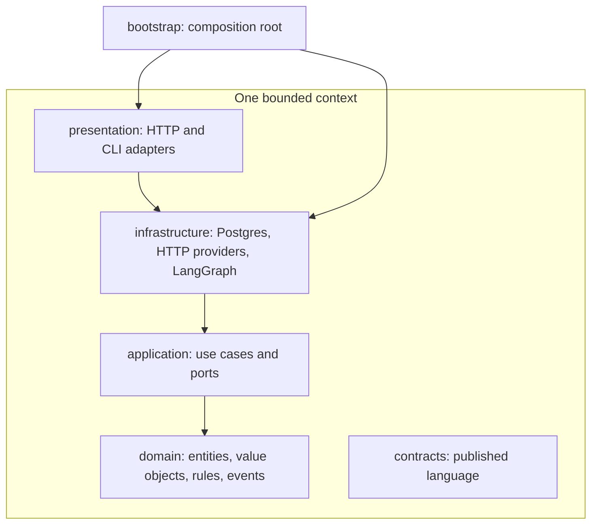

### 8.4 Context map

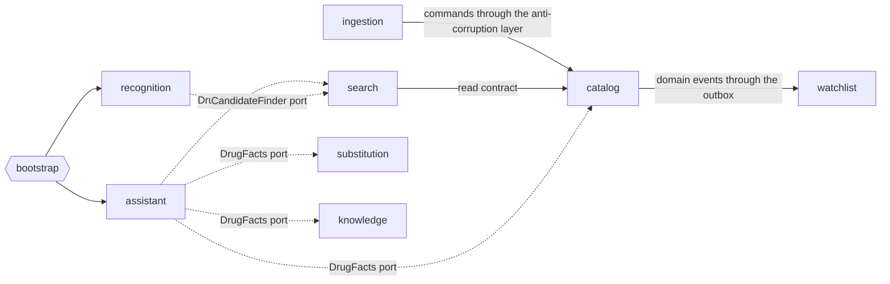

### 8.5 Domain-Driven Design building blocks

| Concept | Where |
|---|---|
| Aggregate with invariants and optimistic concurrency | `catalog/domain/product.py` (`Product`, versioned) |
| Value objects | `IngredientLine`, `Money`, `Currency`, `Provenance`, `Strength`, `Citation`, `ExtractedLine` |
| Domain events and transactional outbox | `catalog/domain/events.py`, `catalog/infrastructure/persistence/outbox.py` |
| Repository and unit of work | `catalog/infrastructure/persistence/` |
| Anti-corruption layer | `ingestion` maps SFDA pages into catalog commands |
| Published language | the `contracts` package of each context |
| Ports and adapters | every external capability (database, crawler, model, voice, vision) |
| One schema per context | `catalog`, `search`, `knowledge`; no cross-schema keys or joins |

### 8.6 Scalability

- Stateless API processes behind a load balancer; configuration from the environment.
- PostgreSQL with per-context schemas, trigram and vector indexes; Redis for queues and caches.
- Crawls, OCR and embeddings run as resumable background jobs.
- The outbox decouples contexts, so any context can later move to its own service without changing its
  domain ([ADR-001](docs/adr/ADR-001-modular-monolith-vs-microservices.md),
  [ADR-004](docs/adr/ADR-004-scalability.md)).
- Provider failures degrade gracefully: vision falls back across models, retrieval falls back to text
  search, each AI feature answers 503 until its key is configured while the rest keeps working.

## 9. Data

### 9.1 Sources

All data comes from the official SFDA website, crawled politely: robots.txt respected, requests throttled
with jitter, crawls stop on blocks and never touch CAPTCHA-protected forms. Every record keeps its
provenance and the trust level `official`.

| Source | Records | Used for |
|---|---|---|
| Registered drugs list and details (Arabic and English) | 9,162 | Catalog, search, drug page, assistant |
| Drug safety alerts | 276 | Safety intelligence, knowledge base |
| Drugs circulars and withdrawals | 146 | Recalls, knowledge base |
| Drug safety labeling updates | 241 (of 261 listed by the site) | Knowledge base |
| Risk minimization measures | 578 | Patient safety center, knowledge base |
| Drug shortages, current and resolved | 723 and 586 | Shortage status |
| Letters to healthcare professionals | 105 | Knowledge base |
| Drug companies | 6,135 | Company views |

### 9.2 Provenance on every record

`source`, `source_ref` (URL or file), `fetched_at`, `snapshot_id` and `trust`. Currencies are never assumed
silently: the SFDA list does not state a currency, so prices carry the basis `owner_assumption` (SAR) and
the app labels them as assumed.

### 9.3 Pipeline

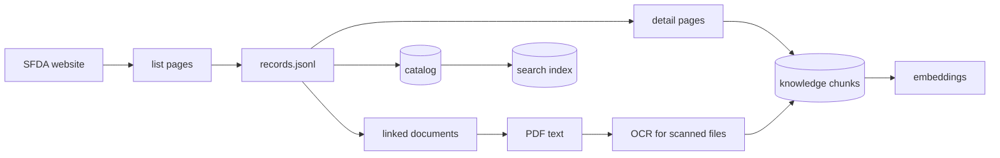

### 9.4 Dataset in the repository

The dataset is versioned under [`data/`](data/): `data/sfda/<run>/records.jsonl` for the drug registry,
`data/lists/<list>/<run>/` for each SFDA list (records, details, documents, texts, manifest), `data/media/`
for the product picture mapping, and `data/exports/catalog_full.csv` as a flat export.

## 10. Tech stack

| Layer | Technology |
|---|---|
| Language and tooling | Python 3.12, uv, ruff, mypy (strict), import-linter, pytest, hypothesis |
| API | FastAPI, Pydantic, Uvicorn |
| Persistence | PostgreSQL 17 with `pg_trgm` and `pgvector`, SQLAlchemy (async), Alembic |
| Queues and cache | Redis |
| Crawling | Playwright (headless Chromium), BeautifulSoup, pypdf, Windows OCR for scanned PDFs |
| AI orchestration | LangGraph, LangChain Core, LangChain OpenAI (OpenAI-compatible endpoints) |
| Model providers | Groq, OpenRouter, ElevenLabs |
| Mobile and web app | React Native with Expo (Expo Router), TypeScript, Phosphor icons, IBM Plex Sans Arabic and Inter |
| Infrastructure | Docker Compose (Postgres, Redis, API), GitHub Actions CI |

## 11. Getting started

### 11.1 Requirements

Python 3.12, [uv](https://docs.astral.sh/uv/), Docker, Node.js 20 or newer, and for the phone the
Expo Go app.

### 11.2 Backend

```bash
cp .env.example .env                      # set the Postgres password and the provider keys you have
uv sync                                   # Python dependencies
docker compose up -d db redis             # PostgreSQL (pg_trgm, pgvector) and Redis
uv run alembic upgrade heads              # every context's schema
```

### 11.3 Load the data shipped in the repository

```bash
uv run pharmavique sfda-load --run-id full-20261116 --from-records   # 9,144 drugs into the catalog
uv run pharmavique search-reindex                                     # the search index
uv run pharmavique sfda-lists-load --run-id lists-1                   # SFDA lists, linked to products
uv run pharmavique knowledge-build --run-id lists-1                   # cited chunks for the assistant
```

### 11.4 Run the API

```bash
uv run uvicorn pharmavique.bootstrap.api:create_app --factory --host 0.0.0.0 --port 8000
```

Open `http://127.0.0.1:8000/docs` for the interactive API documentation and `/metrics` for metrics.

### 11.5 Run the app on a phone

```bash
cd mobile
npm ci
EXPO_PUBLIC_API_URL=http://<computer LAN address>:8000 npx expo start
```

Scan the QR code with Expo Go. The phone and the computer must be on the same network. For a browser,
run `npx expo start --web --port 8081`.

### 11.6 Refresh the SFDA data

```bash
uv run pharmavique sfda-update --run-id <new run id>     # drug registry, incremental
bash scripts/recollect_safety_lists.sh                    # the six safety lists, end to end
```

## 12. Configuration reference

All settings are environment variables with the `PHARMAVIQUE_` prefix, read from `.env`. Secrets are never
committed; [`.env.example`](.env.example) lists every variable with placeholders.

| Variable | Default | Purpose |
|---|---|---|
| `DATABASE_URL` | none | PostgreSQL connection (async driver) |
| `REDIS_URL` | none | Redis connection |
| `CORS_ORIGINS` | local app origins | Browser origins allowed to call the API |
| `GROQ_API_KEY` | none | Assistant model, prompt guard, speech to text, optional voice |
| `OPENROUTER_API_KEY` | none | Embeddings and vision models |
| `ELEVENLABS_API_KEY` | none | Saudi Arabic voice |
| `LLM_PROVIDER` | `groq` | `groq` or `openrouter` |
| `LLM_MODEL` | `openai/gpt-oss-120b` | Language model with tool calling |
| `PROMPT_GUARD_MODEL` | `meta-llama/llama-prompt-guard-2-86m` | Injection classifier; empty disables it |
| `EMBEDDING_MODEL` | `baai/bge-m3` | Embedding model |
| `EMBEDDING_DIMENSIONS` | `1024` | Vector size stored in pgvector |
| `VISION_MODELS` | three free vision models | Tried in order for scans |
| `STT_MODEL` | `whisper-large-v3-turbo` | Speech to text |
| `TTS_PROVIDER` | `elevenlabs` | `elevenlabs` or `groq` |
| `ELEVENLABS_MODEL` | `eleven_v3` | ElevenLabs model |
| `ELEVENLABS_VOICE_ID` | a default voice | Set to a Saudi Arabic voice from the ElevenLabs voice library |
| `TTS_MODEL` | `canopylabs/orpheus-arabic-saudi` | Groq voice model |
| `TTS_VOICE` | `noura` | Groq Saudi voice: abdullah, fahad, sultan, lulwa, noura or aisha |

## 13. Command line reference

| Command | Purpose |
|---|---|
| `pharmavique sfda-scrape --run-id ID` | Full crawl of the registered drugs list (resumable) |
| `pharmavique sfda-update --run-id ID` | Incremental refresh against the latest run |
| `pharmavique sfda-diff --old A --new B` | Changes between two runs |
| `pharmavique sfda-load --run-id ID [--from-records]` | Load a run into the catalog |
| `pharmavique sfda-lists [--lists a,b]` | Crawl the other SFDA lists |
| `pharmavique sfda-list-details`, `sfda-list-files`, `sfda-list-texts`, `sfda-list-ocr` | Detail pages, documents, PDF text, OCR |
| `pharmavique sfda-lists-load --run-id ID` | Load the lists and link rows to products |
| `pharmavique knowledge-build --run-id ID` | Cut official documents into cited chunks |
| `pharmavique search-reindex` | Rebuild the search index |
| `pharmavique search "query"` | Try the search from the terminal |
| `pharmavique sfda-images*` | Product picture pipeline |

## 14. API reference

| Method | Path | Purpose |
|---|---|---|
| GET | `/health` | Liveness |
| GET | `/metrics` | Prometheus metrics |
| GET | `/v1/search?q=&limit=&include_withdrawn=` | Find drugs by name, ingredient or register number |
| GET | `/v1/products/{register_number}` | Product card |
| GET | `/v1/products/{register_number}/details` | Drug page: every field with provenance |
| GET | `/v1/products/{register_number}/same-ingredient` | Same ingredient set, cheapest first, with verdict |
| POST | `/v1/assistant/ask` | Cited answer to a question |
| POST | `/v1/voice/transcribe` | Audio upload to text |
| POST | `/v1/voice/speak` | Text to audio in the Saudi Arabic voice |
| POST | `/v1/recognition/scan?kind=box` or `kind=prescription` | Photo to medicine lines with registry candidates |

Example: ask the assistant.

```http
POST /v1/assistant/ask
Content-Type: application/json

{"question": "What is the active ingredient of Panadol Extra?", "level": "pharmacist", "spoken": false}
```

```json
{
  "answer": "Panadol Extra contains paracetamol 500 mg and caffeine citrate 65 mg per tablet [1].",
  "citations": [
    {"number": 1, "source_id": "catalog:0206257530", "kind": "catalog",
     "url": "https://www.sfda.gov.sa/en/drugs-list", "published": null, "title": "PANADOL EXTRA TAB"}
  ],
  "grounded": true, "general": false, "urgent": false, "refused": false,
  "level": "pharmacist", "tools_used": ["search_drugs", "drug_details"],
  "disclaimer": "Informational only, not medical advice. ..."
}
```

Example: scan a box.

```json
{
  "kind": "box",
  "status": "needs_review",
  "lines": [{
    "raw_text": "Panadol Extra", "name": "Panadol Extra", "strength": null, "form": "tablet",
    "dose": null, "needs_review": true,
    "candidates": [
      {"register_number": "0206257530", "trade_name_en": "PANADOL EXTRA TAB", "score": 1.0},
      {"register_number": "2207257788", "trade_name_en": "PANADOL EXTEND 665MG F.C. TABLETS", "score": 0.611}
    ]
  }]
}
```

## 15. Testing and quality gates

Run before every commit and in CI ([`.github/workflows/ci.yml`](.github/workflows/ci.yml)):

```bash
uv run ruff check . && uv run ruff format --check .
uv run mypy src tests            # strict typing
uv run lint-imports              # the eight architecture contracts
uv run pytest                    # unit, architecture and integration tests
cd mobile && npx tsc --noEmit    # the app's types
```

- More than 760 automated tests: unit tests per layer, architecture tests, and integration tests against a
  real PostgreSQL.
- Tests come before adapters, and every bug fix starts with a failing test.
- Every port has a fake adapter, so AI behaviour (tool calls, citations, guardrails, fallbacks) is tested
  with scripted models and mock HTTP transports, without network access or keys.

## 16. Security and privacy

- No secrets in the repository: keys live only in `.env` and the environment.
- Health data is minimised: photos and audio are processed in memory and dropped with the request;
  questions, answers, images and audio are never logged.
- Provider keys are sent only in the Authorization header of their own provider and never appear in errors.
- Text from official documents is treated as data and never as instructions to the model.
- Crawling is polite: robots.txt, throttling, a clear user agent, stop on blocks, no CAPTCHA bypass.

## 17. Repository layout

```
src/pharmavique/
  <context>/
    contracts/        published language of the context
    domain/           entities, value objects, rules, events
    application/      use cases and ports
    infrastructure/   adapters: Postgres, HTTP providers, LangGraph, crawlers
    presentation/     HTTP and CLI adapters
  shared_kernel/      market, currency, money, provenance, text normalization
  foundation/         database engine, throttling, robots rules, concurrency
  bootstrap/          composition root: settings, API, CLI, observability
tests/
  unit/ · architecture/ · integration/
mobile/               Expo app (Expo Router), right-to-left, light and dark
pharmavique-wireframes/  wireframe canvas and brand assets
data/                 the SFDA dataset
docs/                 architecture, ADRs, plans, data sources, media
scripts/              crawl, OCR and maintenance scripts
migrations/           Alembic environment
```

## 18. Documentation index

| Document | Content |
|---|---|
| [Project brief](docs/PROJECT_BRIEF.md) | Goals, audiences, scope |
| [Architecture](docs/ARCHITECTURE.md) | Contexts, layers, data ownership |
| [AI architecture](docs/AI_ARCHITECTURE.md) | Search, OCR, assistant, retrieval design |
| [Domain model](docs/DOMAIN_MODEL.md) | Aggregates, value objects, invariants |
| [Features](docs/FEATURES.md) | Product decisions |
| [Phase 2 plan](docs/PHASE_2_PLAN.md) | Application and AI plan with the owner's decisions |
| [Data sources](docs/DATA_SOURCES.md) | Every source, licence status, probe results |
| [SFDA scraper](docs/SFDA_SCRAPER.md) | Crawler behaviour and site quirks |
| [Media pipeline](docs/MEDIA_PIPELINE.md) | Product pictures |
| [Open questions](docs/OPEN_QUESTIONS.md) | Unknowns waiting for decisions |
| [ADR-001](docs/adr/ADR-001-modular-monolith-vs-microservices.md) · [002](docs/adr/ADR-002-job-queue.md) · [003](docs/adr/ADR-003-search-strategy.md) · [004](docs/adr/ADR-004-scalability.md) · [005](docs/adr/ADR-005-ai-providers-behind-ports.md) · [006](docs/adr/ADR-006-pgvector-and-document-chunks.md) · [007](docs/adr/ADR-007-langgraph-in-infrastructure.md) | Architecture decision records |

## 19. Roadmap

1. Finish loading the six SFDA safety lists and fill the knowledge base with their documents.
2. App screens for the assistant (with listen), voice search, box and prescription scan.
3. My medication list and safety check: duplicate active ingredient, ingredient allergy, recalls and alerts.
4. Accounts, tenants and roles; alerts on a user's medicines through the outbox relay.
5. Price history from SFDA snapshots, and online pharmacy prices marked as unverified.
6. Egypt as a CSV-import adapter marked unverified. Drug interactions wait for a licensed source.

## 20. Disclaimer

Pharmavique provides information from official registry data and public SFDA publications. It is not
medical advice and does not replace a doctor or a pharmacist. It never gives a personal dose and never
tells anyone to stop or switch a prescribed medicine.
