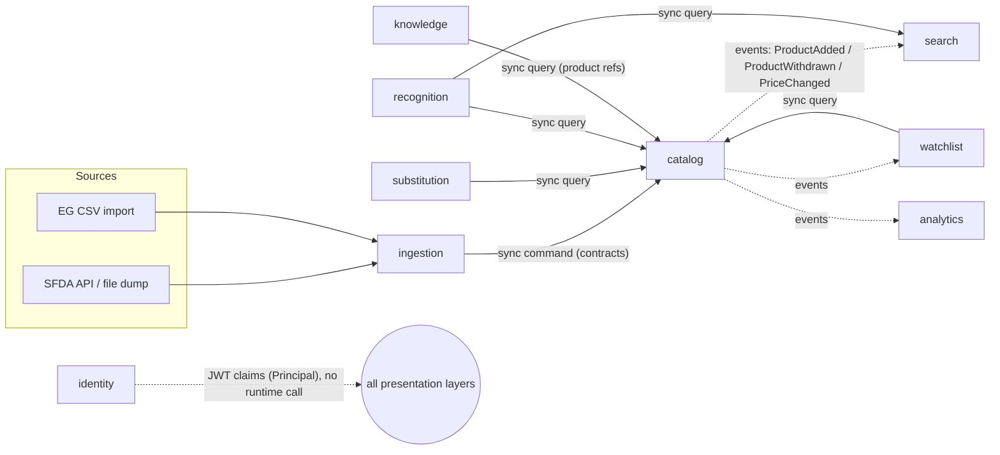

# Architecture Overview

| | |
|---|---|
| Status | **Accepted (Phase 0, 2026-11-16: owner said to proceed with the recommendations as written; decisions D-1 to D-8 remain reversible)** |
| Date | 2026-11-16 |
| Scope | Context map, layer rules, module communication, path to extracted services |
| Related | [PROJECT_BRIEF.md](PROJECT_BRIEF.md), [REPOSITORY_STRUCTURE.md](REPOSITORY_STRUCTURE.md), [ADR-001](adr/ADR-001-modular-monolith-vs-microservices.md), [ADR-002](adr/ADR-002-job-queue.md), [ADR-003](adr/ADR-003-search-strategy.md), [OPEN_QUESTIONS.md](OPEN_QUESTIONS.md) |

Anything marked **[Decision D-n]** is a choice I made where the brief was silent or ambiguous. They are collected in `OPEN_QUESTIONS.md` section A so you can confirm or reverse them.

---

## 1. Goals and shape

A multi-tenant drug-intelligence platform on official registry data (SA first, EG pluggable), serving patients, pharmacists and pharma companies from one shared core. The workload is read-heavy lookups, bursty photo recognition, and periodic bulk ingestion.

The system is a **modular monolith**: one deployable codebase, one PostgreSQL cluster, nine bounded contexts with machine-enforced boundaries, built so any context can later be extracted into its own service without rewriting its business logic (see section 7 and ADR-001).

Guiding principles:

1. **Domain first.** Business rules (equivalence, normalization, provenance) live in pure Python with no I/O.
2. **Dependencies point inward.** Enforced by `import-linter` in CI, not by convention.
3. **Boundaries are designed as if remote.** A context talks to another only through a small published contract, never through its internals or its tables.
4. **Uncertainty is a first-class value.** "Possible, needs pharmacist check", `trust=unofficial_unverified`, `currency=unconfirmed` are modeled explicitly, never defaulted away.
5. **No invented facts.** Unknown source fields, prices and currencies are recorded as open questions, not guessed.

---

## 2. Context map

### 2.1 Contexts

| Context | Owns (write model) | Type |
|---|---|---|
| `catalog` | Products, active ingredients, strengths, dosage forms, manufacturers, registrations, per-market listings, price history | Core |
| `substitution` | Equivalence rules and ranking (pure domain service). Owns **no tables** in Phase 1 | Core |
| `ingestion` | Source connectors, snapshots, normalization pipeline, diff engine, ingestion runs | Core (supporting for EG) |
| `recognition` | Photo-to-fields jobs, vision port, match results | Core |
| `search` | Search projection (normalized names, aliases, trigram + vector indexes), Arabic/English normalization | Supporting |
| `knowledge` | **Parked** (2026-11-17): leaflet documents and chunks, only once a leaflet source exists (Q-24). Retrieval over the catalog lives in `search` | Supporting |
| `assistant` | **Planned, not before search is measured** (see `AI_ARCHITECTURE.md`): conversations, tool-using loop, citations, guardrails, cost ledger | Supporting |
| `media` | **Planned** (see `AI_ARCHITECTURE.md` section 14): product pictures found on the web, their verification and provenance. Nothing is downloaded until Q-35 is answered | Supporting |
| `identity` | Users, roles, tenants, RBAC policy | Generic |
| `watchlist` | Personal medicine lists, alert rules, notification preferences | Supporting |
| `analytics` | Read models for the company view (market map, gaps, competitor radar) | Supporting |

### 2.2 Relationships



Solid arrows are synchronous in-process calls through `contracts`. Dashed arrows are asynchronous integration events delivered via the outbox. Arrow direction is *consumer → provider* for calls and *publisher → subscriber* for events.

| Provider (upstream) | Consumer (downstream) | Mechanism | Relationship pattern |
|---|---|---|---|
| `catalog` | `ingestion` | Sync command: `ApplyCatalogChanges` | Ingestion conforms to catalog's published language; **anti-corruption layer** in ingestion translates source schemas into catalog commands |
| `catalog` | `search` | Events | Search keeps its own projection and can be rebuilt from catalog |
| `catalog` | `watchlist`, `analytics` | Events (+ sync query for backfill/lookup) | Customer/supplier; consumers translate into their own models |
| `catalog` | `substitution`, `recognition`, `knowledge` | Sync query | Open host service; consumers hide it behind their own port |
| `search` | `recognition` | Sync query | Recognition asks search for candidate matches |
| `identity` | every presentation layer | Signed token claims | Published language: `Principal` in `shared_kernel`. No per-request call to identity |

Notes:

- `substitution` is a pure domain service. It receives ingredient/strength/form data through a port implemented by an adapter over `catalog.contracts`. It never queries catalog tables.
- `analytics` builds **its own projection tables** from catalog events (initial backfill through a paginated export in `catalog.contracts`). Materialized views are defined over analytics-owned tables only, never over another context's tables. **[Decision D-5]**
- **[Decision D-1] Who emits `ProductAdded` / `ProductWithdrawn` / `PriceChanged`.** The brief lists change events under `ingestion`. I propose that `ingestion`'s diff engine produces a `ChangeSet` and sends it to `catalog` as a command, and `catalog` emits the three events through its outbox in the same transaction that changes its state. Reason: these are facts about the catalog's state, and emitting them from the context that owns that state keeps the event and the state change atomic. `ingestion` itself emits run-level events (`SnapshotIngested`, `IngestionRunFailed`).

### 2.3 Shared kernel (kept deliberately tiny)

`shared_kernel` is framework-free and holds only concepts that several contexts genuinely share:

- Identifiers and tenancy: `TenantId`, `UserId`, `Principal`, `Role`
- `Market` (`SA`, `EG`), `Currency` (with an explicit `unconfirmed` state), `Money`
- `Provenance` (source, source_url_or_file, fetched_at, snapshot_id) and `TrustLevel` (`official`, `unofficial_unverified`)
- Base types: `DomainEvent`, `IntegrationEvent` (`event_id`, `occurred_at`, `schema_version`)
- Technical ports: `Clock`, `UnitOfWork` (base protocol), `JobQueue`, `ObjectStorage`

Changes to the shared kernel need review of every context that uses it. If a concept is used by only two contexts, it belongs in one context's `contracts`, not here.

`foundation` (technical building blocks with zero domain knowledge: DB engine/session, outbox relay, event bus, Redis, queue adapter, throttled HTTP client, object-storage implementations, OpenTelemetry/logging, JWT verification) sits beside it. `foundation` may import `shared_kernel`; neither may import any context.

---

## 3. Layers inside each context

Each context is a package with four layers plus a published `contracts` package:

| Layer | Contains | May import | Must not import |
|---|---|---|---|
| `domain` | Entities, value objects, domain services, domain events, domain errors | own `domain`, `shared_kernel`, stdlib | any framework or driver, own `application`/`infrastructure`/`presentation`, any other context |
| `application` | Command/query handlers (use cases), ports (repositories, gateways, UoW), DTOs | own `domain`, `shared_kernel`, stdlib | frameworks, drivers, pydantic **[D-3]**, own `infrastructure`/`presentation`, any other context |
| `infrastructure` | Outbound adapters: SQLAlchemy repositories and read queries, Redis, queue, HTTP clients, LLM/VLM clients, object storage, source connectors, **adapters over other contexts' `contracts`**, Alembic migrations | own `application`/`domain`, `shared_kernel`, `foundation`, third-party libs, *other contexts' `contracts` (allow-listed)* | own `presentation`, other contexts' internals |
| `presentation` | **All inbound adapters [D-2]**: FastAPI routers and schemas, the in-process implementation of the context's `contracts`, integration-event subscribers | own `application`, own `contracts`, `shared_kernel`, `foundation` (auth dependency), FastAPI/pydantic, *other contexts' `contracts.events` (allow-listed)* | own `domain` **[D-4]**, own `infrastructure`, other contexts' internals |
| `contracts` | Published language: `Protocol`s for sync calls, frozen DTOs, integration events (versioned) | `shared_kernel`, stdlib | any layer of its own context, any other context |

Dependency direction inside a context:

```
presentation ──► application ──► domain
infrastructure ──► application ──► domain
(presentation and infrastructure never import each other)
```

The **composition root** is `bootstrap` (outside every context). It is the only place that sees everything: it builds the DI container, binds ports to adapters, registers routers, event subscriptions and worker functions. Nothing imports `bootstrap`.

Consequences of the rules, stated plainly:

- A use case in `application` depends on **its own** ports. When `substitution` needs ingredient data it declares `IngredientCatalogReader` in `substitution.application.ports`; the adapter in `substitution.infrastructure.adapters` implements it on top of `catalog.contracts`. Extracting `catalog` later means replacing that one adapter with an HTTP client. Use-case code does not change.
- The cost is some DTO translation between contexts. That duplication is the price of an anti-corruption layer and is accepted.
- Presentation never touches domain objects; it maps request schemas to application DTOs/commands and back. Enums that clients need are exposed through application DTO modules.

Rules that `import-linter` cannot express are covered by architecture tests in `tests/architecture/` (for example: no cross-schema foreign keys, every published integration event is registered with a schema version). See [REPOSITORY_STRUCTURE.md](REPOSITORY_STRUCTURE.md).

---

## 4. How modules communicate

### 4.1 Decision table

| Need | Use | Why |
|---|---|---|
| Caller needs the answer now to respond (equivalents lookup, candidate matches, product existence check) | **Synchronous call** through the provider's `contracts` queries, behind a consumer-owned port | Simple, low latency, same process today, HTTP tomorrow |
| Caller tells a provider to change its state and needs the outcome (`ingestion` → `catalog`) | **Synchronous command** through `contracts` commands; provider runs its own transaction | One transaction per context, ever |
| Something happened that others may react to (price changed, product withdrawn, leaflet indexed) | **Integration event** via transactional outbox | Decouples release and failure; allows replay and rebuild of projections |
| Long-running or bursty work (photo recognition, bulk ingestion, embedding) | **Job** via `JobQueue` port, state authoritative in Postgres | Never in the request cycle; see ADR-002 |

### 4.2 Synchronous calls: rules

1. Only through `<provider>.contracts` and only from an allow-listed adapter module (the allow-list lives in the import-linter config, so every new edge is a reviewed diff).
2. Design as if remote: coarse-grained, serializable frozen DTOs, no ORM objects, no shared sessions or transactions, explicit timeouts at the adapter, errors mapped to the consumer's own exceptions.
3. Prefer queries. Commands across contexts are rare and must be idempotent.
4. No call cycles. The context map above is acyclic for sync edges; adding an edge that closes a cycle requires an ADR.

### 4.3 Events: domain vs integration

- **Domain events** are raised by aggregates inside one context and never leave it.
- **Integration events** are the published, versioned subset in `<context>.contracts.events`. They are the only events other contexts may subscribe to. They carry IDs and the facts consumers need (for example `PriceChanged` carries old and new price, currency, market, provenance), not references to internal tables.

### 4.4 Transactional outbox

```
command handler
   └─ UoW.begin
        ├─ mutate aggregate(s)
        ├─ append integration events to  <context>.outbox  (same transaction)
        └─ UoW.commit
relay worker (poll, FOR UPDATE SKIP LOCKED)
   └─ read unpublished rows in order
        └─ dispatch to subscribers
              └─ each subscriber: own transaction + dedupe on (event_id, subscriber)
                   └─ mark processed
```

- Delivery is **at-least-once**; subscribers are **idempotent** (dedupe table keyed by `event_id` and subscriber name).
- Ordering is not guaranteed across aggregates. Events carry `occurred_at` and an aggregate `version`; projections apply last-writer-wins by version, so replays and reorders are harmless.
- In the monolith the relay invokes subscribers in-process. Moving to a broker later changes the relay's sink only; the outbox and event contracts stay.
- Projections (`search`, `analytics`) are **rebuildable**: a rebuild command replays from catalog's paginated export in `contracts`, so a corrupted or schema-changed projection is never a migration emergency.

### 4.5 Initial event catalogue

Events marked *(brief)* come from the brief; the rest are my proposal and not yet confirmed.

| Event | Publisher | Subscribers | Source |
|---|---|---|---|
| `ProductAdded` | `catalog` | `search`, `watchlist`, `analytics` | brief |
| `ProductWithdrawn` | `catalog` | `search`, `watchlist`, `analytics` | brief |
| `PriceChanged` | `catalog` | `watchlist`, `analytics` | brief |
| `ProductDetailsChanged` | `catalog` | `search`, `analytics` | proposed (aliases, names, strength corrections) |
| `SnapshotIngested` / `IngestionRunFailed` | `ingestion` | `analytics` (freshness), ops alerting | proposed |
| `LeafletIndexed` | `knowledge` | none initially | proposed |
| `AlertTriggered` | `watchlist` | notification adapter | proposed |

### 4.6 Data ownership

- One PostgreSQL cluster, **one schema per context** (`catalog`, `ingestion`, `search`, ...). A context reads and writes only its own schema.
- **No cross-schema foreign keys, no cross-context joins.** Cross-context references are opaque IDs (for example `watchlist.items.product_id`), validated through contracts at write time and tolerated as dangling after the fact (a withdrawn product stays visible to the user as withdrawn).
- Separate DB roles per context are a Phase 7 hardening option; the schema separation makes it possible without redesign.

---

## 5. Cross-cutting concerns

| Concern | Where | Rule |
|---|---|---|
| Provenance | `shared_kernel` type, persisted by `catalog` and `ingestion` | Every stored record carries `source`, `source_url_or_file`, `fetched_at`, `snapshot_id`, `trust`. Never defaulted |
| Currency | `shared_kernel.Currency` | Per market, explicit. `unconfirmed` is a valid state and is surfaced by the API |
| Tenancy | `Principal.tenant_id` from token; tenant-owned tables carry `tenant_id` | Enforced in repositories; isolation covered by tests (row-level security vs application filter is open question Q-14) |
| AuthN / AuthZ | JWT verified in `foundation.auth` to a `Principal`; RBAC checks in `application` | No per-request call to `identity`. Token revocation strategy is open (Q-13) |
| Outbound HTTP | `foundation.http` | Throttled, clear `User-Agent`, cached, respects robots/terms; **no scraping of the EG database and no CAPTCHA bypass** |
| Secrets | Environment variables only; `.env.example` committed | Never hardcoded, logged or committed |
| Sensitive health data | Prescription images and personal lists | Minimum collection, encrypted at rest, uploaded images deleted after processing unless the user opts in, kept out of logs (log scrubbing in `foundation.observability`) |
| Observability | OpenTelemetry traces/metrics, JSON logs | Trace context is propagated through the outbox and job payloads so a trace survives async hops and a future network boundary |
| Medical safety | `presentation` + `knowledge` | Output is never medical advice; no dosing, no "stop/switch" recommendations; LLM answers only from retrieved chunks or catalog data, with citations |

---

## 6. Patterns and where they earn their keep

| Pattern | Used for | Justification | ADR |
|---|---|---|---|
| Modular monolith | Whole system | Lowest operational cost with enforceable seams | ADR-001 |
| Ports and adapters | Every external dependency (DB, cache, queue, LLM/VLM, source connectors, storage, clock, other contexts) | Swappability and testability; the extraction path depends on it | per-port notes in contexts; ADR for LLM/VLM port in Phase 3 |
| CQRS-lite | Separate command and query handlers; dedicated read models in `analytics` and `search` | Read path is 90%+ of traffic and is optimized differently from writes; same DB, no separate event store | ADR-004 (planned) |
| Transactional outbox | Change events | Guarantees an event exists if and only if the state change committed | ADR-004 (planned) |
| Repository + Unit of Work | Persistence per aggregate | UoW at application layer defines the transaction boundary | ADR-005 (planned) |
| Idempotent, resumable ingestion | `ingestion` runs | Deterministic keys (source + snapshot content hash), checkpoints per batch, upsert by natural key; a retried run produces the same result | ADR-006 (planned) |
| Search as a rebuildable projection | `search` | Lets the engine be swapped without touching catalog | ADR-003 |

Deliberately **not** used: event sourcing, a service mesh, a separate message broker, separate databases per context (all revisited only on measured need).

---

## 7. From modular monolith to extracted services

### 7.1 Stages

| Stage | Shape | Trigger to move on |
|---|---|---|
| **0. Modular monolith** (Phase 0 to 2) | One codebase, one deployable image, one DB with a schema per context, one process type | Default |
| **1. Same code, separate process roles** (Phase 1 onward, cheap) | The same image runs as `api`, `worker`, `outbox-relay` via different entrypoints in `bootstrap`; scaled independently | Needed from the first photo-recognition or bulk-ingestion load |
| **2. Extract a context** | The context becomes its own service and, later, its own database | Measured need, see 7.2 |

### 7.2 When to extract (all must be evidenced, not assumed)

A context is extracted when at least one of these is shown by data (load test, production metrics, incident history) and cheaper options (scaling the role, caching, indexing) are exhausted:

- It needs to scale independently and its resource profile differs sharply from the rest (CPU/GPU, memory, long-running work).
- It needs a different release cadence or an isolated blast radius (for example, it depends on a flaky third party).
- It needs different data stores or compliance isolation (for example, prescription images).
- A separate team owns it and coordination cost in the shared deployable is the bottleneck.

Likely first candidates, as hypotheses to test with the Phase 7 load tests: `recognition` (bursty, depends on an external vision provider), the `ingestion` worker role, `knowledge` embedding/indexing. `catalog` and `substitution` are the last to leave because the rest of the system reads from them constantly.

### 7.3 Extraction checklist (what is already in place by design)

| Step | What changes | Already prepared by |
|---|---|---|
| 1. Verify boundary | Confirm the context is clean | import-linter independence contract + allow-list: every inbound and outbound edge is listed |
| 2. Replace consumer adapters | In each consumer, swap the in-process adapter over `provider.contracts` for an HTTP/gRPC client adapter implementing the **same consumer-owned port** | Consumers never imported the provider outside their adapter |
| 3. Expose the provider's contracts remotely | Serve `contracts` queries/commands over HTTP from the provider's existing `presentation` | Contracts are serializable frozen DTOs designed as if remote |
| 4. Split data | Move the context's schema to its own database (logical replication or dual-write window, then cut over) | Schema per context, no cross-schema FKs or joins (enforced by test) |
| 5. Move event transport | Point the context's outbox relay at a broker (choice deferred to a new ADR); subscribers keep the same handlers | Outbox + idempotent subscribers + versioned integration events |
| 6. Version contracts | Contract changes follow additive-first rules; events carry `schema_version` | Versioned from day one |
| 7. Observability and edge | Trace propagation across the new hop, gateway routing (strangler), per-service SLOs | Trace context already carried in events and jobs |

### 7.4 What would make extraction expensive (guarded against)

Shared tables, cross-context joins, importing another context's domain or ORM models, distributed transactions assumed to be local, projections that cannot be rebuilt, and unversioned event payloads. Each of these is blocked by a contract in CI or an architecture test.

---

## 8. Phase 0 non-goals

No application code, no scaffolding, no frontend. The scaffold (uv, FastAPI health endpoint, Docker Compose with Postgres+pgvector and Redis, ruff, mypy, pytest, import-linter, CI) starts only after this document set is approved.
